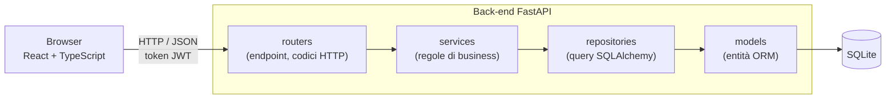
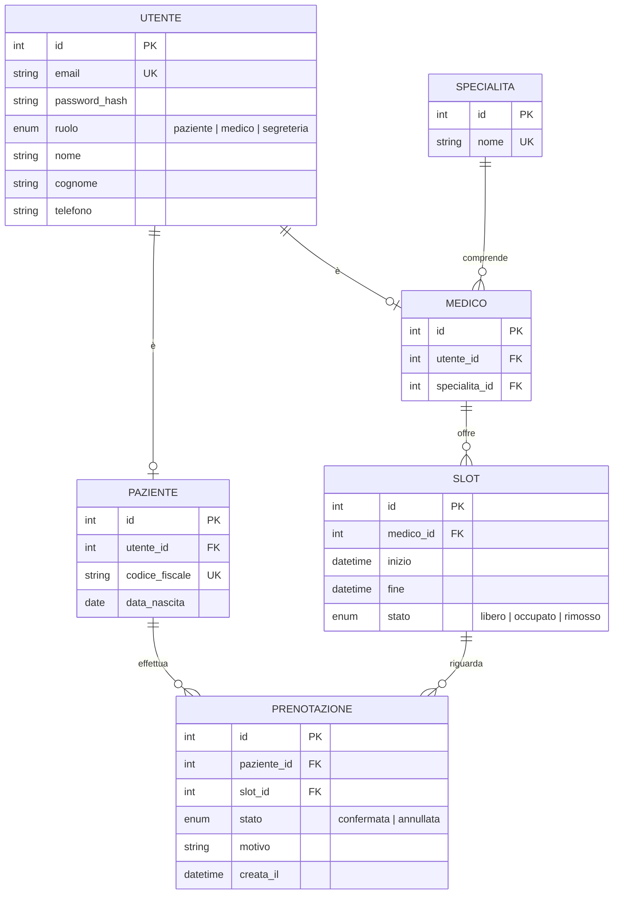

# Poliambulatorio Salus – Prenotazione di visite specialistiche

Applicazione web che permette ai pazienti di un poliambulatorio di prenotare visite
specialistiche online, ai medici di gestire agenda e disponibilità e alla segreteria
di avere una visione d'insieme della clinica.

Il progetto è composto da un **back-end** REST in Python (FastAPI) e da un **front-end**
single-page in React + TypeScript.

---

## Funzionalità

| Ruolo | Cosa può fare |
|---|---|
| **Paziente** | Registrarsi e accedere; scegliere specialità → medico → giorno e prenotare uno slot libero indicando il motivo; consultare le proprie prenotazioni e disdire quelle future. |
| **Medico** | Consultare l'agenda delle visite confermate (per giorno o da oggi in poi); vedere le proprie disponibilità, libere e prenotate; aggiungere nuove disponibilità ed eliminare quelle libere. |
| **Segreteria** | Vedere tutte le prenotazioni in programma (anche quelle annullate); disdirle per conto dei pazienti; creare ed eliminare disponibilità per qualsiasi medico. |

I medici e la segreteria non si registrano dall'applicazione: i loro account vengono
creati dall'amministratore (in questo progetto, con lo script `seed.py`).

---

## Architettura



Il back-end è organizzato a livelli, ognuno con una sola responsabilità:

- **routers** (`app/routers`) – ricevono la richiesta, controllano autenticazione e ruolo,
  traducono le eccezioni del dominio in codici HTTP (404, 403, 409…);
- **services** (`app/services`) – contengono le regole di business (es. "non si prenota
  uno slot già passato") e non sanno nulla di HTTP;
- **repositories** (`app/repositories`) – incapsulano le query al database;
- **models** (`app/models`) e **schemas** (`app/schemas`) – rispettivamente le entità
  salvate nel database (SQLAlchemy) e i dati scambiati con il client (Pydantic, con
  validazione automatica dell'input).

Il front-end (`frontend/src`) è organizzato in `pages` (una per schermata), `components`
riutilizzabili, `api/client.ts` (unico punto in cui si chiama il back-end) e `auth`
(contesto React con l'utente autenticato e protezione delle rotte per ruolo).

### Modello dei dati



`Utente` contiene i dati comuni a tutti (credenziali, nome, ruolo); `Paziente` e `Medico`
ne estendono il profilo con i dati specifici del ruolo.

### Scelte progettuali

- **Nessuna doppia prenotazione, anche con richieste simultanee.** Il servizio controlla
  che lo slot sia libero, ma due richieste contemporanee potrebbero superare entrambe il
  controllo. Per questo il database ha un *indice univoco parziale*: al massimo una
  prenotazione `confermata` per slot. La seconda richiesta fallisce con un errore di
  integrità, che l'API restituisce come `409 Conflict`.
- **Lo storico non si cancella.** Disdire una prenotazione la porta allo stato `annullata`
  e libera lo slot, che può essere prenotato da un altro paziente. Allo stesso modo,
  eliminare una disponibilità la porta allo stato `rimosso` (*cancellazione logica*):
  lo slot può avere prenotazioni annullate collegate, che devono restare consultabili.
- **Uno slot prenotato non si elimina.** Bisogna prima disdire la prenotazione, così il
  paziente non perde la visita senza che nessuno se ne accorga.
- **Autenticazione stateless con JWT.** Al login il server firma un token che contiene
  l'id e il ruolo dell'utente e scade dopo 60 minuti. Le password sono salvate solo come
  hash bcrypt. Se il token scade, il front-end disconnette l'utente e lo riporta al login.
- **Validazione su entrambi i lati.** Il front-end controlla i dati per dare subito un
  riscontro all'utente, ma le regole valgono comunque perché le applica il back-end:
  formato del codice fiscale, password di almeno 8 caratteri, slot solo nel futuro e
  senza sovrapposizioni.
- **Orari locali.** Tutti gli orari sono salvati nell'ora locale della clinica, senza fuso
  orario: la clinica ha una sola sede e la scelta semplifica confronti e visualizzazione.

---

## API principali

La documentazione interattiva completa (Swagger) è disponibile, con il back-end avviato,
su <http://127.0.0.1:8000/docs>.

| Metodo | Percorso | Accesso | Descrizione |
|---|---|---|---|
| POST | `/auth/register` | pubblico | Registrazione di un paziente |
| POST | `/auth/login` | pubblico | Login, restituisce il token JWT |
| GET | `/auth/me` | autenticato | Profilo dell'utente corrente |
| GET | `/specialita` | pubblico | Elenco delle specialità |
| GET | `/medici?specialita_id=` | pubblico | Elenco dei medici, filtrabile |
| GET | `/medici/{id}/slot?data=` | pubblico | Slot liberi di un medico |
| POST | `/prenotazioni` | paziente | Prenota uno slot |
| GET | `/prenotazioni` | paziente, segreteria | Le proprie prenotazioni / tutte |
| DELETE | `/prenotazioni/{id}` | paziente, segreteria | Disdice una prenotazione |
| GET | `/medici/me/agenda?data=` | medico | Visite confermate del medico |
| GET | `/medici/me/slot?data=` | medico | Disponibilità del medico |
| POST | `/slot` | medico, segreteria | Crea una disponibilità |
| DELETE | `/slot/{id}` | medico, segreteria | Elimina una disponibilità libera |

---

## Installazione e avvio

Requisiti: **Python 3.12+** e **Node.js 22.12+** (o 20.19+).

### Back-end

```bash
cd backend
python -m venv .venv
# Windows:      .venv\Scripts\activate
# Linux/macOS:  source .venv/bin/activate
pip install -r requirements.txt

cp .env.example .env    # facoltativo: impostare SECRET_KEY
python seed.py          # crea il database con dati di prova
uvicorn app.main:app --reload
```

L'API è disponibile su <http://127.0.0.1:8000>.

### Front-end

In un secondo terminale:

```bash
cd frontend
npm install
npm run dev
```

L'applicazione è disponibile su <http://localhost:5173>. Se il back-end gira su un altro
indirizzo, copiare `frontend/.env.example` in `frontend/.env` e modificare `VITE_API_URL`.

### Account di prova

Lo script `seed.py` crea 3 specialità, 4 medici, un account di segreteria e gli slot
dei giorni lavorativi delle prossime tre settimane (dalle 9:00 alle 12:00, da 30 minuti). La password di tutti gli account
è `password123`.

| Ruolo | Email |
|---|---|
| Segreteria | `anna.ferri@example.com` |
| Medico (Cardiologia) | `luca.bianchi@example.com`, `elena.conti@example.com` |
| Medico (Dermatologia) | `giulia.verdi@example.com` |
| Medico (Ortopedia) | `marco.neri@example.com` |
| Paziente | da creare con la pagina di registrazione |

---

## Test

```bash
cd backend
pytest
```

I test automatici usano un database SQLite in memoria, ricreato per ogni test, e
verificano tra l'altro:

- registrazione, login e validazione dei dati (email e codice fiscale duplicati,
  formato del codice fiscale, password troppo corta);
- prenotazione e disdetta, compreso il vincolo del database contro le doppie prenotazioni;
- controllo dei permessi per ruolo (un paziente non disdice prenotazioni altrui, un medico
  non elimina gli slot dei colleghi…);
- agenda del medico, gestione delle disponibilità ed esclusione degli slot già trascorsi.

Per il front-end: `npm run lint` (analisi statica) e `npm run build` (controllo dei tipi
TypeScript e build di produzione).

---

## Tecnologie

| Livello | Tecnologie |
|---|---|
| Back-end | Python, FastAPI, SQLAlchemy 2, Pydantic 2, PyJWT, bcrypt |
| Database | SQLite (sostituibile cambiando `DATABASE_URL`) |
| Front-end | React 19, TypeScript, React Router, Vite |
| Test | pytest, TestClient di FastAPI |

---

## Limiti e possibili sviluppi

- **Migrazioni del database.** Le tabelle vengono create all'avvio. In produzione andrebbe
  introdotto uno strumento di migrazione come Alembic, per far evolvere lo schema senza
  perdere dati.
- **Database.** SQLite è adatto allo sviluppo. Per un uso reale con più utenti
  contemporanei conviene PostgreSQL: l'indice univoco parziale è già definito anche per
  PostgreSQL, basta installare il driver e cambiare `DATABASE_URL`.
- **Notifiche.** Un promemoria via email prima della visita e un avviso al paziente quando
  la segreteria disdice la sua prenotazione.
- **Gestione account.** Recupero della password, modifica del profilo e un'area di
  amministrazione per creare medici e specialità senza usare lo script.
- **Ricerca per la segreteria.** Filtri lato server (per medico, data, paziente) e
  paginazione dell'elenco delle prenotazioni.
- **Test del front-end.** Test dei componenti (es. con Vitest e Testing Library) e test
  end-to-end dei flussi principali.
